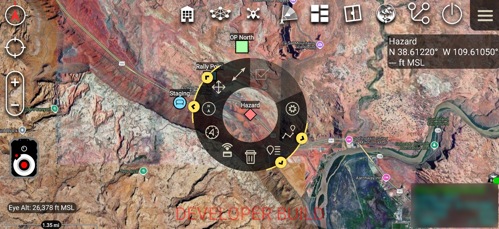
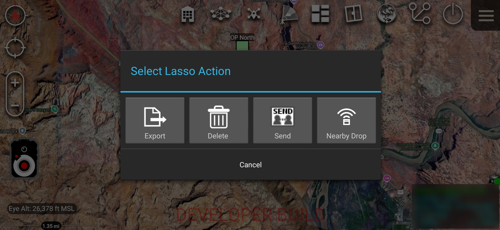
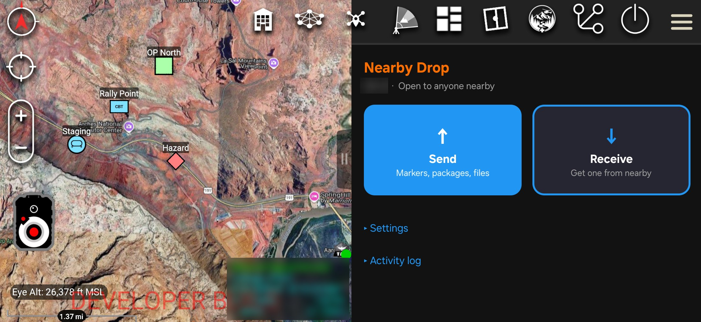
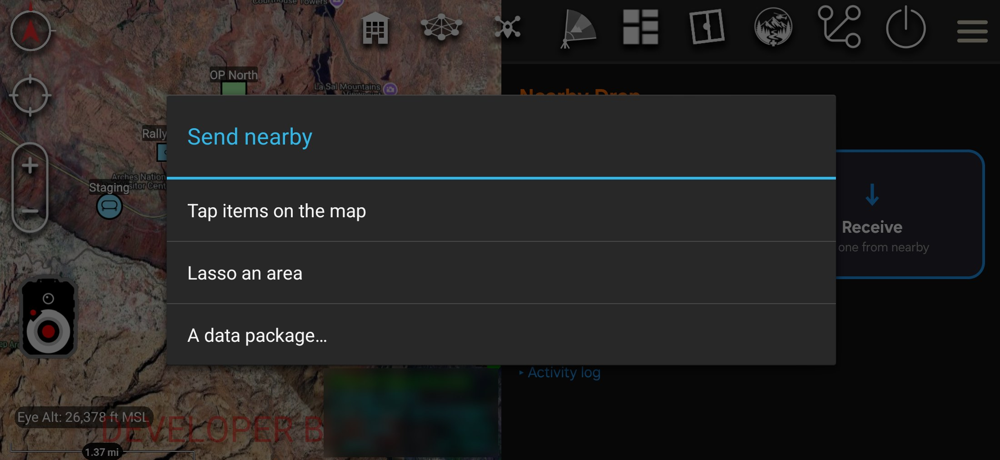
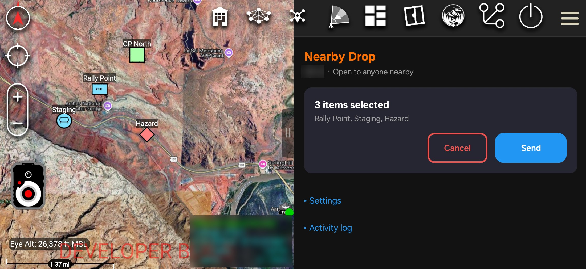
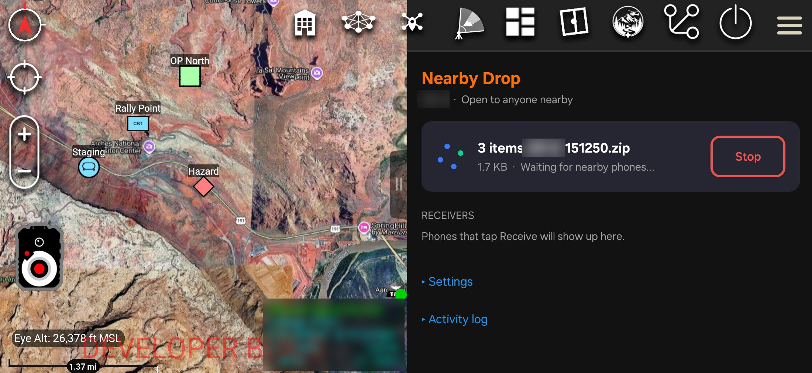

# Nearby Drop

An ATAK plugin that sends markers, data packages and files straight to the ATAK phones
around you. No TAK Server, no mesh network, no cell service, and no shared Wi-Fi needed.
Think AirDrop for ATAK.



## What it does

- **Send markers, routes and shapes.** Pick one, a handful, or everything in a lasso, and
  every nearby phone that taps **Receive** gets them on its map.
- **Send data packages and files.** Anything in ATAK's Data Packages list, or any file ATAK
  can share.
- **One to many.** One phone offers, any number of nearby phones pull the same package.
- **See it before you take it.** Receivers see who is sending what, and how big it is,
  before they connect, and accept or ignore it.
- **Team codes.** Phones only see offers from phones with the same team code (blank =
  anyone nearby).
- **Imports like a server delivery.** Received packages go through ATAK's normal importer,
  so markers land on the map and data packages show up in Data Packages.

## Ways to send

| Where | How |
|---|---|
| Marker / route / shape radial menu | Tap the **Nearby Drop** button (Wi-Fi arcs over a box) |
| ATAK's **Lasso Select** tool | Draw a lasso, Select, then choose **Nearby Drop** |
| Data Packages (and other ATAK send dialogs) | **Send** → **Nearby Drop** |
| The plugin pane | **Send** → *Tap items on the map*, *Lasso an area*, or *A data package…* |

On the receiving phone, open Nearby Drop and tap **Receive**.

| | |
|---|---|
|  |  |
| Nearby Drop in ATAK's Lasso Select actions | The plugin pane |
|  |  |
| What to send | Tap items on the map to pick them |
|  | |
| Offering the package to nearby phones | |

## How it works

Nearby Drop uses Google's
[Nearby Connections](https://developers.google.com/nearby/connections/overview) API in the
`P2P_STAR` strategy: the sending phone is the hub and each receiver connects to it.

1. The sender advertises an **offer** (callsign, file name, size) inside the Nearby
   advertisement itself, so receivers see it before any connection is made.
2. Accepting connects. The link starts on Bluetooth and Nearby moves it to Wi-Fi on its own
   (same network, Wi-Fi Aware, Wi-Fi Direct or a hotspot, whichever the two phones support).
3. The sender pushes the file; the receiver saves it to `atak/tools/nearbydrop/`, hands it
   to ATAK's importer, and reports back so the sender can show **Delivered**.

Map items are packaged as a small data package (a few KB for a handful of markers), so
they import exactly like a data package from a TAK Server.

On two test phones, a 25 MB package took about 9–12 seconds with **no shared Wi-Fi network**
(Nearby used Wi-Fi Aware) and under 2 seconds when both phones were on the same network.

## Install

Download the APK for your ATAK version from
[Releases](https://github.com/RyanR3/NearbyDrop/releases). The APKs are built and signed by
the TAK Product Center, so they load in the production ATAK-CIV from the Play Store or
tak.gov.

| ATAK | APK |
|---|---|
| 5.6 | `ATAK-Plugin-TAKNearbyDrop-0.1--5.6.0-civ-release.apk` |
| 5.7 | `ATAK-Plugin-TAKNearbyDrop-0.1--5.7.0-civ-release.apk` |
| 5.8 | `ATAK-Plugin-TAKNearbyDrop-0.1--5.8.0-civ-release.apk` |

Install the APK, then in ATAK open **Plugins**, and load **Nearby Drop** if it is not loaded
already.

### Requirements

- ATAK-CIV 5.6, 5.7 or 5.8 (use the matching APK).
- **Google Play services** on the phone (Nearby Connections is part of it).
- Bluetooth and location on. ATAK already holds the Bluetooth, location and Nearby Wi-Fi
  permissions the plugin needs.

## Settings

- **Team code** — only phones with the same code see each other's offers. It is a filter,
  not encryption.
- **Allow leaving my Wi-Fi network** — lets phones that lack Wi-Fi Aware use a faster direct
  link, which briefly drops their current Wi-Fi network. Turn it off if that network carries
  your TAK traffic (for example a mesh radio).
- **Auto-accept packages from my team** — receivers download offers without tapping Accept.

A send stays open for 15 minutes or until you tap **Stop**. The **Activity log** shows the
connect time, link type and speed for each phone.

## Limitations

- Nothing is encrypted beyond what Nearby Connections provides; the team code only
  controls who can see an offer.
- ATAK's built-in **Send** buttons in a marker's details and in the lasso's own Send go to
  the contact list, which plugins cannot add to. Use the radial button or the lasso's
  **Nearby Drop** action instead.
- A Bluetooth-only transfer cannot be forced: Google Play services turns Wi-Fi on when it
  needs it.
- The sending phone keeps a copy of each package it builds from map items in its Data
  Packages list.

## Building from source

You need the ATAK-CIV SDK for the ATAK version you are targeting.

1. Copy `template.local.properties` to `local.properties` and fill in `sdk.dir`, and either
   your tak.gov artifact credentials or `sdk.path` pointing at the extracted
   `ATAK-CIV-<version>-SDK` folder.
2. Copy the SDK's `main.jar` into `app/libs/`.
3. Build:

```sh
./gradlew assembleCivDebug                   # ATAK 5.7, debug
./gradlew -Patak=5.6.0 assembleCivDebug      # another ATAK release (with that SDK's main.jar)
./gradlew assembleCivRelease                 # release build (needs sdk.path)
```

A locally built plugin is signed with the SDK's debug key and only loads in a developer
build of ATAK. For production ATAK, use the TAK Product Center builds from Releases.

### Notes for developers

- ATAK ships no Google Play services code, so the plugin bundles
  `play-services-nearby`. Play services reads `com.google.android.gms.version` from the
  calling app's manifest, which ATAK does not have; `Gms.prime()` reads it once through a
  context that reports the plugin's own package, after which every Nearby call runs on
  ATAK's context and permissions. It uses an obfuscated Play services class, so re-check it
  whenever the `play-services-nearby` version changes.
- `versionCode` is derived from `PLUGIN_VERSION` (0.1 → 100), never from git, so
  git-less builds still upgrade cleanly under MDM.

## Version

0.1 — first release.
